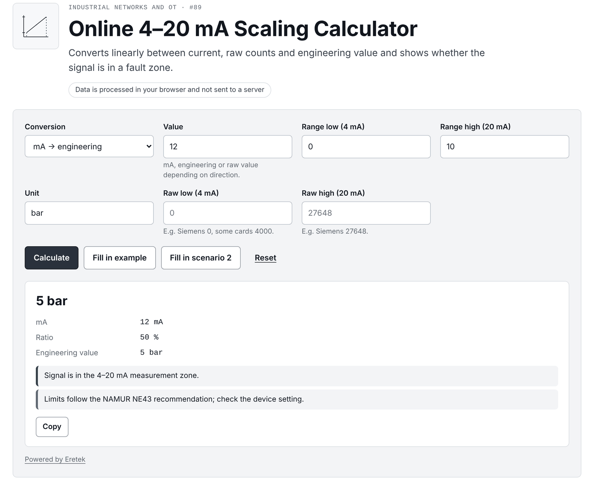

# 4–20 mA Scaling Calculator

Convert 4–20 mA current to engineering units, engineering values to mA and PLC raw analog counts (e.g. 0–27648) to scale; shows NAMUR NE43 fault zones.

## Try it live

- [Türkçe](https://endustriyel.eretek.com/araclar/4-20-ma-olcekleme)
- [English](https://endustriyel.eretek.com/en/tools/4-20-ma-scaling)
- [Deutsch](https://endustriyel.eretek.com/de/werkzeuge/4-20-ma-skalierung)



## What it does

Converts linearly between current, raw counts and engineering value and shows whether the signal is in a fault zone.

In a 4–20 mA signal 4 mA is the bottom and 20 mA the top of the range; below 4 mA usually means a broken wire or sensor fault. PLCs convert current to raw counts (Siemens 0–27648, many cards 4000–20000). Commissioning needs quick, error-free conversion between these three values.

## Where it helps

Compare the scaling with the values entered in the PLC/SCADA; do a three-point check by applying 4, 12 and 20 mA with a loop calibrator.

## How to use it

1. Choose the direction: mA → engineering, engineering → mA or raw → engineering.
2. Enter the range (low/high) and unit; for raw mode enter the card's raw low/high values.
3. Enter the value and press Run.

### Fields

| Field | Description |
|---|---|
| Conversion |  |
| Value | mA, engineering or raw value depending on direction. |
| Range low (4 mA) |  |
| Range high (20 mA) |  |
| Unit |  |
| Raw low (4 mA) | E.g. Siemens 0, some cards 4000. |
| Raw high (20 mA) | E.g. Siemens 27648. |

## Example input

Press **Fill in example** in the tool to load this input.

| Input | Value |
|---|---|
| Conversion | `mA → engineering` |
| Value | `12` |
| Range high (20 mA) | `10` |
| Unit | `bar` |

**Expected result:** In a 0–10 bar range 12 mA = 50 % = 5 bar; the signal is in the normal zone.

## Method and assumptions

Ratio = (mA − 4) / 16 = (raw − raw low) / (raw high − raw low) = (value − low) / (high − low). Reversed ranges (e.g. 20 mA = 0) are supported.

NAMUR NE43: 3.8–20.5 mA measurement (limited overrange below 4 and above 20), 3.6 mA or below and 21 mA or above fault.

## Limits and common mistakes

- A linear conversion is assumed; square-root (flow) or table characteristics, 0–20 mA and voltage inputs need separate handling.

## Run it locally

The tool is plain HTML, CSS and JavaScript with no build step and no dependencies.

```bash
git clone https://github.com/eretek/4-20-ma-scaling.git
cd 4-20-ma-scaling
node scripts/serve.js        # or: python3 -m http.server 8080
```

Open <http://127.0.0.1:8080/>. Add `?lang=tr` or `?lang=de` for Turkish or German; without it the page follows the browser language and falls back to English. You can also open `index.html` directly from disk.

Run the tests (Node.js 18 or later):

```bash
node test/run.js    # or: npm test
```

The tests run the tool's own fixtures and the worked examples in all three languages without a browser.

## How it works

All processing happens in your browser. The tool makes no network requests, uses no cookies or browser storage, and does not upload files you select.

No server-side component is needed. The version on the Eretek website renders the same page through a private WordPress plugin; that plugin only produces the page markup and is not part of this repository.

| Path | Purpose |
|---|---|
| `index.html` | Page shell |
| `src/app.js` | Builds the page in Turkish, English or German from `src/data.js` |
| `src/data.js` | Field definitions, examples and all texts in three languages |
| `src/core.js` | Shared runtime: validation, number formats, result rendering, CSV/ICS export |
| `src/tool.js` | The calculation or analysis for this tool |
| `docs/screenshot.png` | Screenshot used in this README |
| `src/tools.css`, `src/page.css` | Styles |
| `test/run.js`, `test/cases.json` | Headless tests |

## License and attribution

This tool is released under the [Eretek Website Attribution License](LICENSE). You may use, modify and redistribute it, including commercially. If you make it available on a website or web application, show a visible, clickable credit linking to https://eretek.com/ on every page where the tool is available, for example:

```html
<a href="https://eretek.com/">Powered by Eretek</a>
```

You may add `rel="nofollow"` to the link. Keep the copyright notice and license text in copies and redistributions.
